# SIMULAÇÃO DA DESFOLHA EM PLANTIOS DE *Eucalyptus* COM O MODELO 3-PG: EFEITO NO CRESCIMENTO E NA PRODUÇÃO DE MADEIRA

Bernardo Teixeira de Castro

Trabalho de Conclusão de Curso II apresentado ao curso de Engenharia Florestal, Campus Monte Carmelo, da Universidade Federal de Uberlândia, como parte dos requisitos para obtenção do grau de Bacharel em Engenharia Florestal.

Orientador: Prof. Álvaro Augusto Soares

---

## 1 INTRODUÇÃO

O modelo 3-PG (*Physiological Principles Predicting Growth*) é uma ferramenta de crescimento processual usada para estimar a produção de povoamentos florestais. A cada mês, calcula a luz captada pela copa, transforma essa energia em biomassa e distribui o crescimento entre folhas, tronco e raízes, segundo a idade e os fatores de temperatura, água e fertilidade (LANDSBERG; WARING, 1997; SANDS; LANDSBERG, 2002). O índice de área foliar — área foliar sobre a área do terreno — é uma ligação central desse cálculo: quanto menor é a copa, menos luz é captada e menos biomassa pode ser produzida.

Insetos desfolhadores e doenças foliares interrompem esse processo ao retirar folhas ou reduzir a eficiência das que permanecem. A madeira perdida depende da intensidade do dano, do número de eventos e da época do ataque, além do material genético e das condições do sítio (PINKARD et al., 2006; MATRANGOLO et al., 2010). Medir todas essas combinações no campo exigiria vários anos e condições padronizadas. Por isso, este trabalho usa o modelo para comparar cenários controlados e mantém a distinção entre previsão, calibração e confirmação empírica.

O 3-PG já foi parametrizado para eucaliptos brasileiros, principalmente pela rede TECHS, mas sua versão original não representa desfolha por pragas ou doenças (CALDEIRA et al., 2020). Trabalhos anteriores acoplaram danos ao 3-PG ou a modelos semelhantes. Rua et al. (2020) avaliaram desfolha em *Eucalyptus globulus* em Portugal, mas com outra espécie, clima e agente. Oliveira et al. (2014) mediram perda de volume em *E. grandis* jovem no sul da Bahia, e Matrangolo et al. (2010) acompanharam desfolhas sucessivas em *E. grandis* até 92 meses. Esses resultados são úteis para comparar magnitudes e persistência, mas não validam por si só uma aplicação em *E. urophylla*.

Assim, o problema central é representar o dano foliar em um motor brasileiro de 3-PG e decidir quais resultados são apenas previstos pelo modelo e quais são apoiados por dados independentes. Este trabalho integra três tipos de dano — retirada de folhas, perda temporária de eficiência e mortalidade imposta — e acrescenta três formas de reação da árvore: aumento da fotossíntese das folhas remanescentes, recuperação da transpiração e maior alocação de crescimento às folhas. A reação foi calibrada com dados publicados de Bertulio et al. (2008), não medida neste projeto.

A abordagem é integralmente simulacional. Foram usados dados secundários, clima diário da NASA POWER e parâmetros publicados de clones e híbridos. Não houve coleta de campo. Esse desenho permite controlar a intensidade, a frequência e a época do ataque, mas não transforma uma comparação bibliográfica em validação independente. A confirmação empírica deve envolver inventários compatíveis de local, material, idade, área foliar e desfolha, dados que não foram localizados nesta etapa.

Este trabalho atende ao problema por cinco etapas verificáveis: (1) integrar o módulo sem alterar a versão original; (2) conferir o motor contra implementações de referência; (3) calibrar a reação da árvore; (4) avaliar a importância estatística da intensidade, da frequência e da época; e (5) separar confirmações internas, comparações adaptadas e limitações não resolvidas.

## 2 OBJETIVOS

**Objetivo geral.** Desenvolver e avaliar um módulo de desfolha acoplado ao modelo 3-PG, parametrizado para materiais de eucalipto em sítios brasileiros, quantificando estatisticamente como a perda de volume depende da intensidade, da frequência e da época do ataque.

**Objetivos específicos.**

1. Acrescentar ao 3-PG retirada de folhas, perda temporária de eficiência, mortalidade de árvores e reação fisiológica, sem alterar os resultados da versão original sem desfolha.
2. Verificar a implementação por comparação com o r3PG e contra a implementação usada na plataforma, distinguindo esse teste de uma validação de campo.
3. Calibrar os parâmetros de reação da árvore com Bertulio et al. (2008), registrar sua incerteza e testar o ajuste por validação cruzada interna.
4. Comparar o módulo com experimentos publicados como benchmarks adaptados e declarar quais informações seriam necessárias para uma validação independente.
5. Quantificar a resposta de cada material e sítio por análise estatística dos cenários simulados e publicar os resultados em forma reproduzível.

## 3 MATERIAL E MÉTODOS

O trabalho usa dados secundários e simulação computacional. Não houve coleta de campo.

### 3.1 Modelo

O 3-PG calcula a produção mensal de biomassa a partir da radiação interceptada pelo dossel, modificada por temperatura, déficit de pressão de vapor, água disponível e fertilidade (LANDSBERG; WARING, 1997). A implementação usada é o motor do projeto Akademia, em Python, com equações conferidas contra a versão em JavaScript do simulador. Na comparação de oito cenários, a diferença relativa entre as duas versões foi de 1,4 × 10⁻¹⁴.

O módulo de desfolha remove, em cada mês de ataque, uma fração da área foliar proporcional à intensidade escolhida. A intensidade pode ser de 25%, 50% ou 95% da copa. A desfolha pode ocorrer uma única vez, todos os anos durante seis anos ou em abril, julho ou outubro. A compensação fisiológica aumenta a fotossíntese por folha que permanece após a perda, e a recuperação restabelece o índice de área foliar. Os parâmetros de compensação usados são U = 1,18, a = 0,625, γ = 1,0 e atraso de um mês, valores medianos da calibração descrita em 3.4.

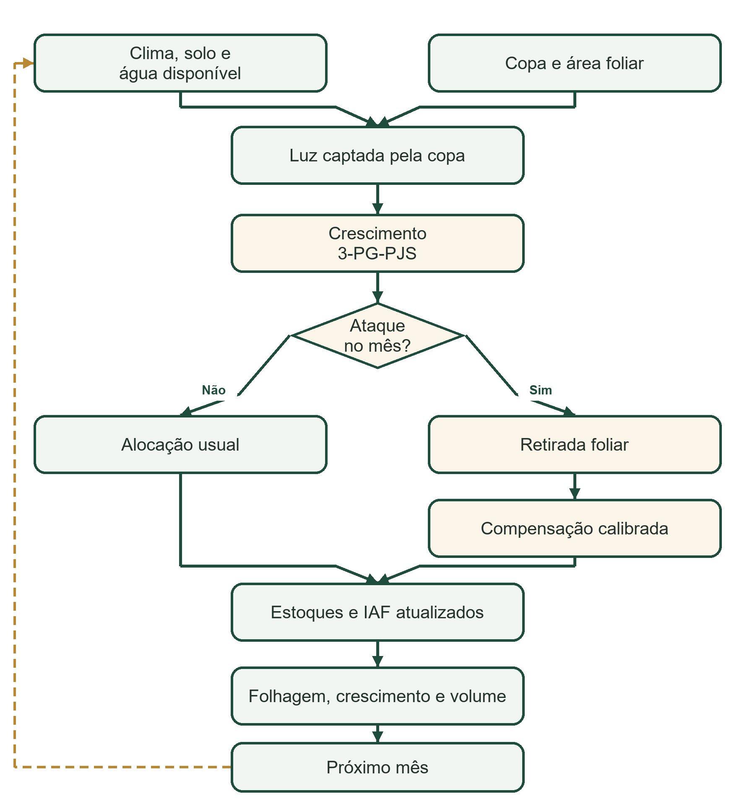

### 3.2 Materiais genéticos

Foram usados cinco materiais clonais e um modelo de parâmetros, todos de *Eucalyptus* plantados no Brasil e com parâmetros publicados em fonte identificada. A escolha seguiu três critérios: (1) ter parâmetros do 3-PG publicados e identificados; (2) representar eucalipto plantado em clima e solo contrastantes; (3) permitir comparar a resposta à desfolha entre materiais.

**A1** é um clone de *Eucalyptus urophylla* da rede TECHS (Tolerância de Clones de Eucalipto ao Estresse Hídrico, Térmico e Biótico), com parâmetros de Caldeira et al. (2020). Foi escolhido por apresentar a maior plasticidade fenotípica entre os clones avaliados pela rede, isto é, o melhor desempenho relativo em ambientes diferentes. Os parâmetros de partição de biomassa de A1 diferem dos publicados para outros materiais do gênero (CALDEIRA et al., 2020). A1 é o material de referência do trabalho e foi simulado nos três sítios.

**C1, C2, C3, C4 e C5** são híbridos clonais de *Eucalyptus grandis* × *Eucalyptus urophylla*, não de *E. urophylla* puro. Os clones 3334 e 3336 foram avaliados em Curvelo-MG e Itacambira-MG, com idades de 3 a 84 meses (BORGES et al., 2012). A diferença entre C1 e C3 e entre C2 e C4 está no clone e no local: C1 e C2 são de Curvelo; C3 e C4 são de Itacambira, conforme a origem dos parâmetros. C5 não é um clone; é um conjunto de parâmetros médios para o Cerrado de Minas Gerais, derivado desses dados (BORGES et al., 2012).

Em Curvelo, o clone 3334 foi muito mais produtivo que o 3336; em Itacambira, os dois tiveram produtividade semelhante (BORGES et al., 2012). Essa diferença de ordem entre locais é um exemplo direto de interação genótipo × ambiente.

**Quadro 1 – Materiais genéticos, origem dos parâmetros e sítios simulados**

| Material | Espécie ou híbrido | Origem dos parâmetros | Sítios simulados |
|---|---|---|---|
| A1 | *Eucalyptus urophylla*, clone da rede TECHS | Caldeira et al. (2020), Tabela 1 e §2.7 | IND, IMP, TB |
| C1 | *E. grandis* × *E. urophylla*, clone 3334, Curvelo-MG | Borges et al. (2012) | IND, IMP, TB |
| C2 | *E. grandis* × *E. urophylla*, clone 3336, Curvelo-MG | Borges et al. (2012) | IND, IMP, TB |
| C3 | *E. grandis* × *E. urophylla*, clone 3334, Itacambira-MG | Borges et al. (2012) | IND, IMP, TB |
| C4 | *E. grandis* × *E. urophylla*, clone 3336, Itacambira-MG | Borges et al. (2012) | IND, IMP, TB |
| C5 | Conjunto médio de parâmetros para o Cerrado de Minas Gerais | Borges et al. (2012) | IND, IMP, TB |

Os oito parâmetros do motor sem fonte brasileira são kF, thinPower, mF, mR, mS, MinCond, Qa e Qb. Eles têm o mesmo valor em todos os seis materiais, pois vêm da coluna de *E. globulus* de Sands e Landsberg (2002): kF = 0,0; thinPower = 1,5; mF = 0,0; mR = 0,2; mS = 0,2; MinCond = 0,0; Qa = −90,0; Qb = 0,8. Como vários valores são zero, uma variação relativa de ±10% não se aplica a eles, e por isso não entraram na análise de Morris (seção 4.7).

#### 3.2.1 Genótipo, ambiente e fenótipo

O fenótipo de uma árvore (como crescimento, volume ou resposta à desfolha) depende do genótipo (o material genético), do ambiente (clima, solo e manejo) e da interação entre os dois. Binkley et al. (2017) analisaram clima, espaçamento e genética em clones de eucalipto no Brasil e no Uruguai e mostraram que esses fatores atuam juntos sobre o crescimento. Bertulio et al. (2008) desfolharam dois clones de *Eucalyptus* com a mesma intensidade e observaram respostas diferentes: o urograndis cresceu mais que o urocam, mas teve maior interrupção do crescimento depois da desfolha, o que os autores atribuem à genética.

O modelo 3-PG representa o genótipo apenas por meio dos parâmetros de cada material. Não há um termo explícito de interação genótipo × ambiente. Assim, as diferenças entre materiais nos resultados deste trabalho vêm dos parâmetros de cada clone aplicados ao clima e ao solo de cada sítio. Isso significa que o modelo pode reproduzir uma diferença de produtividade entre clones quando ela já está nos parâmetros, mas não pode prever uma mudança na ordem entre clones que não esteja representada neles. Essa é uma limitação para a pergunta de como o genótipo afeta o fenótipo, e a análise de sensibilidade pode testar se a ordem entre clones muda quando os parâmetros variam.

### 3.3 Sítios e dados ambientais

Foram usados três sítios: Indianópolis-MG (IND), Imperatriz-MA (IMP) e Telêmaco Borba-PR (TB). IND e IMP estão no Cerrado; TB, na Mata Atlântica. O TECHS 9 fica em Estrela do Sul-MG, cerca de 35 km de Indianópolis; é uma referência regional próxima, não uma parcela de campo em IND nem uma correspondência direta do município. O TECHS 22 fica em Telêmaco Borba-PR. Segundo Binkley et al. (2017), cada parcela da rede tem 8 linhas de 30 árvores, espaçamento de 3 × 3 m (1.111 árvores por hectare), com adubação intensiva no primeiro ano. O trabalho usa o período de crescimento de 24 a 36 meses publicado por esses autores, que corresponde ao meio da rotação de seis anos. Para o TECHS 9, a precipitação anual nesse período foi de 1.412 mm e o déficit hídrico de 298 mm; para o TECHS 22, foi de 1.554 mm e 29 mm. A água disponível de 0 a 2 m é de 215 mm no TECHS 9 e 214 mm no TECHS 22. Os solos são Latossolos (Oxisols) argilosos, com 80% e 56% de argila, respectivamente (BINKLEY et al., 2017, Tabela 2). Em relação aos dados do NASA POWER usados para IND e TB, a precipitação do TECHS 9 é cerca de 25% maior e a do TECHS 22 cerca de 10% maior; a diferença de período entre as duas fontes é declarada na seção 3.3.

- **Clima:** temperatura, precipitação e radiação diárias da NASA POWER, de 01/01/2015 a 31/12/2024, agregadas por mês. Para Telêmaco Borba, a série usada nas simulações é uma estimativa em grade nas coordenadas municipais (−24,3239; −50,6158), não uma série meteorológica medida na parcela TECHS 22.
- **Água disponível:** 215 mm para IND e 214 mm para TB, valores coincidentes com a água disponível de 0 a 2 m dos sítios 9 e 22 da rede TECHS (CALDEIRA et al., 2020; BINKLEY et al., 2017). Para IMP, a água disponível não tem referência de campo.
- **Fertilidade (FR):** valor fixo por material, sem estimativa a partir do solo. A relação entre FR e propriedades do solo não está estabelecida (NUNES et al., 2022).
- **Idade:** plantio no mês zero, desfolha aos 12 meses e horizonte de 84 meses. Para o sítio TECHS 9 (Estrela do Sul-MG, mesma região de IND), o plantio foi em dezembro de 2011 e a colheita em maio de 2018 (ALMEIDA, 2021, Capítulo 2, Tabela 2). Para o sítio TECHS 22 (Telêmaco Borba-PR, 24,2° S e 50,5° O; altitude de 888 m), as coordenadas e a altitude constam da Tabela 3 de Silva et al. (2022). A data de plantio informada em metadados de dissertação é 29/02/2012, a confirmar com o registro primário do projeto TECHS. A série meteorológica diária específica da parcela TECHS 22 para 2012 a 2018 não está disponível publicamente, e não tivemos acesso a esses dados. Por isso, as simulações usam a série NASA POWER municipal de Telêmaco Borba, de 2015 a 2024.
- **Dados de campo TECHS:** não tivemos acesso aos dados brutos de inventário das parcelas TECHS 9 e 22. As informações agregadas publicadas são usadas apenas nos benchmarks identificados no texto; não permitem reconstruir séries por árvore ou validar as simulações por variável.

### 3.4 Calibração da compensação

A calibração usou o experimento de desfolha artificial sucessiva com clones de *Eucalyptus* em Campo Verde-MT, em que dois clones foram desfolhados duas vezes (BERTULIO et al., 2008). O material desse experimento é um híbrido urograndis, e não o A1; por isso, o resultado é tratado como transferência. A calibração ajustou U, a e γ de modo que a perda simulada se aproximasse da observada nesse experimento. A versão original do modelo, sem compensação, foi mantida para comparação.

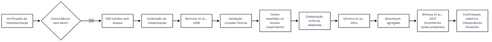

### 3.5 Cenários

Para cada material e sítio, foram simulados o controle sem desfolha e desfolhas de 25%, 50% e 95%. Cada ataque foi testado como evento isolado, repetição anual por seis anos ou ocorrência em abril, julho ou outubro. Cada cenário foi comparado com o controle da mesma versão, original ou calibrada, pela perda de volume aos 84 meses, em porcentagem. O script que gera os cenários está no repositório do projeto e reproduz todas as saídas deste trabalho.

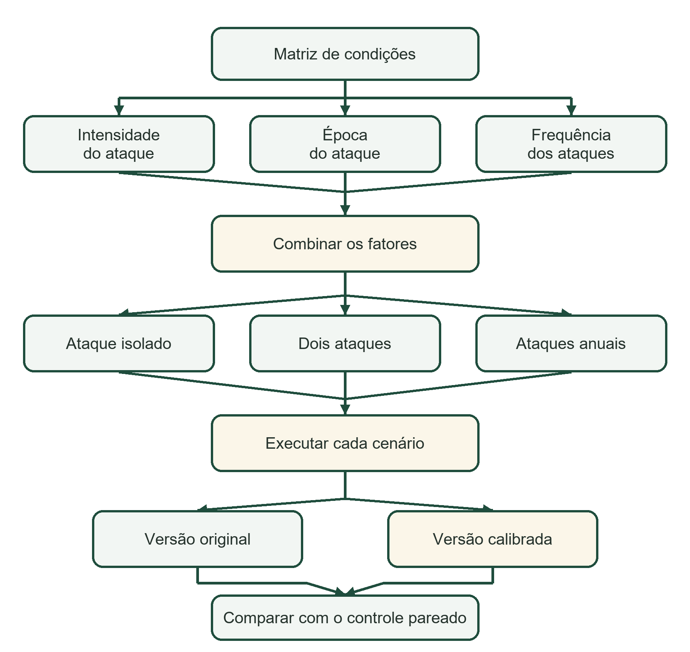

### 3.6 Avaliação do modelo e alcance dos resultados

O trabalho separa três etapas, que não se condicionam entre si.

1. **Dados de entrada.** Clima, solo e dados silviculturais necessários para executar as simulações, obtidos e tratados quando disponíveis. Para Telêmaco Borba, a entrada é a série diária NASA POWER de 2015 a 2024 nas coordenadas municipais, agregada por mês. Ela não é uma medição na parcela TECHS 22. A série meteorológica diária específica da parcela TECHS 22 para 2012 a 2018 não está disponível publicamente, e não tivemos acesso a esses dados. Também não tivemos acesso aos dados brutos de inventário das parcelas TECHS 9 e 22; os resumos publicados não substituem registros individuais nem permitem validação independente por variável.
2. **Avaliação do modelo.** Testes internos, verificações numéricas, análise de sensibilidade e comparação com implementações de referência. Essas etapas são feitas com os dados secundários disponíveis.
3. **Confirmação empírica.** Comparação entre resultados simulados e observações independentes. Só é feita se houver dados de local, material genético, idade, variáveis dendrométricas e período de medição compatíveis. Quando esses dados não estão disponíveis, a etapa não é substituída por comparações bibliográficas, e a limitação é declarada.

Comparações com resultados publicados (Oliveira et al., 2014; Matrangolo et al., 2010; Rua et al., 2020) são tratadas como comparações de ordem de grandeza, não como validação experimental. O teste de Oliveira et al. (2014) usa outra espécie e o clone C5, e é reportado como comparação adaptada.

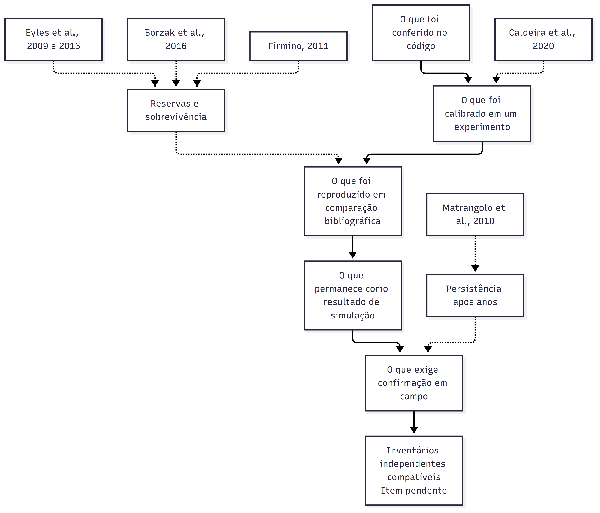

### 3.7 Reprodutibilidade

O metamodelo é reproduzido por `experimentos/estatisticas.py`, que restringe a análise aos registros de `E1-E6` e `LOCAL` marcados como aptos. Os preditores são intensidade, número e época dos ataques, água disponível, fertilidade, sítio e material genético; VPD não é um preditor. O arquivo climático NASA POWER contém RH2M, mas o cálculo de `vpd_day` em `experimentos/clima.py` usa apenas as temperaturas mínima e máxima. O script `teste_vpd.py` citado em versões anteriores não está nesta versão do repositório; portanto, não há aqui um teste reproduzível que isole o efeito de VPD com RH2M.

O código, os dados de entrada e as saídas versionadas estão no repositório do projeto. Os testes automáticos do modelo passaram, e a auditoria numérica conferiu as entradas e saídas registradas. A validação cruzada do metamodelo avalia sua capacidade de reproduzir saídas simuladas; não é validação independente do modelo em campo. A auditoria numérica não cobre todos os números do texto.

### 3.8 Trajetória metodológica e organização do projeto para reutilização

Esta seção descreve como o modelo foi construído, quais fontes sustentam cada escolha e o que pode ser reutilizado por outros pesquisadores. Ela também separa o que foi verificado do que ainda depende de dados externos.

#### 3.8.1 Fontes e critério de seleção

As fontes foram lidas integralmente quando seu conteúdo era usado como dado ou como comparação. Entraram no trabalho: Rua et al. (2020), Caldeira et al. (2020) e seu material suplementar, Binkley et al. (2017), Oliveira et al. (2014), Matrangolo et al. (2010), Bertulio et al. (2008), Nunes et al. (2022), Nunes et al. (2023), Firmino (2011), Almeida (2021), Sands e Landsberg (2002) e Landsberg e Waring (1997). Uma lista maior de referências, organizada no repositório, não foi usada como evidência: os itens que ainda não foram conferidos na fonte primária ficaram fora do texto.

**Quadro 2 – Organização das evidências por tema**

| Tema | Fonte principal | Uso no trabalho | Situação |
|---|---|---|---|
| Desfolha | Rua et al. (2020); Oliveira et al. (2014); Matrangolo et al. (2010) | Estrutura de cenários de intensidade e frequência; comparação com perdas publicadas | Comparação, não validação |
| Compensação fisiológica | Turnbull et al. (2007); Pinkard et al. (2007), citados em Rua et al. (2020) | Justificativa do aumento de fotossíntese por folha remanescente | Calibrada contra Bertulio et al. (2008) |
| Mortalidade | Caldeira et al. (2020), suplemento (sobrevivência de 86% a 100%) | Não simulada; declarada como limite | Limite |
| Parâmetros fisiológicos | Caldeira et al. (2020), Tabela 1; Sands e Landsberg (2002) | Parâmetros de *E. urophylla* e oito parâmetros de *E. globulus* | Oito parâmetros sem fonte brasileira |
| Solos | Binkley et al. (2017), Tabela 2; Nunes et al. (2022) | Água disponível de 215 mm (TECHS 9) e 214 mm (TECHS 22); fertilidade fixa por material | FR não estimado a partir do solo |
| Clima | NASA POWER; Binkley et al. (2017), Tabela 1 | Séries diárias para os seis locais de simulação, agregadas por mês; resumos publicados para 24 a 36 meses nos TECHS 9 e 22 | Série municipal de TB usada como entrada; série específica da parcela TECHS 22 (2012–2018) não disponível publicamente e sem acesso neste trabalho |
| Validação e comparação | Bertulio et al. (2008); Oliveira et al. (2014); Caldeira et al. (2020) | Calibração, validação cruzada interna e comparações adaptadas | Confirmação empírica pendente |

#### 3.8.2 Processo que levou às escolhas

O desenvolvimento seguiu a sequência: revisão das fontes; levantamento e conferência dos dados; consolidação dos parâmetros, com a origem de cada valor registrada no código; implementação do módulo de desfolha no motor 3-PG; calibração da compensação contra o experimento de Bertulio et al. (2008); comparação adaptada com resultados publicados; e, por fim, a análise de limitações. Cada etapa deixou um arquivo no repositório, de modo que cada número do texto pode ser rastreado até um script e a um conjunto de dados.

Na verificação do motor, a versão em Python foi comparada com a implementação em planilha, com R² mínimo de 0,9996 e erro quadrático relativo máximo de 0,13%. Um *crosscheck* direto registrado no repositório comparou o pacote r3PG em R e o motor do projeto em 23.873 pares por variável; a diferença relativa máxima foi de 5,288 × 10⁻¹⁵, abaixo do limite de 2 × 10⁻¹³. Essa verificação se restringe aos dados registrados e avalia a implementação, não o desempenho do modelo nem sua confirmação em campo.

A calibração da compensação resultou em U = 1,18 (intervalo de 90%: 1,01 a 1,34), a = 0,625 (0,225 a 0,975) e γ = 1. A validação cruzada interna foi feita dentro do experimento de Bertulio et al. (2008), com o erro quadrático médio relativo caindo de 15,72 para 4,31 pontos percentuais na divisão leave-one-out. Essa validação não mede desempenho em outros plantios.

#### 3.8.3 Modelo final e fluxo de dados

O fluxo de dados segue a ordem: parâmetros documentados por material (com fonte e origem de cada valor) → dados de entrada por sítio (clima diário, água disponível, fertilidade fixa e idade inicial) → motor 3-PG com módulo de desfolha → matriz de cenários (22.752 linhas, 6 materiais, 6 sítios, 2 versões, dos quais 20.856 são aptos) → indicadores de perda de volume, biomassa, índice de área foliar e recuperação → análise de sensibilidade e metamodelo de floresta aleatória → figuras e tabelas do texto. A matriz completa está versionada no repositório, e o script que a gera reproduz as 22.752 linhas. Os cenários de referência para sítios e materiais são gerados por script próprio.

O metamodelo de floresta aleatória é um ajuste estatístico sobre os resultados simulados. Ele não é uma validação independente do 3-PG.

#### 3.8.4 Disseminação e parametrização futura

Para que outro pesquisador possa aplicar o modelo, cada novo material ou sítio deve ser registrado com os seguintes metadados mínimos: identificação do material e espécie ou híbrido; fonte e origem de cada parâmetro; local, coordenadas e altitude; série climática diária e período de cobertura; água disponível e textura do solo; idade inicial e data de plantio, quando conhecidas; variáveis medidas, com unidade e período; e indicação de independência em relação aos dados usados no ajuste. O repositório já contém um validador de material que confere campos obrigatórios e os 82 parâmetros do motor antes de um novo material entrar no simulador.

A transferência entre contextos depende de critérios explícitos: o material deve ter parâmetros de fonte própria; o clima do sítio deve estar dentro do intervalo coberto pela calibração; e a comparação com observações deve usar dados independentes do ajuste. Quando algum desses critérios não é atendido, o resultado é tratado como cenário, e não como previsão para o local.

#### 3.8.5 Relação entre repositórios, arquivos do TCC, registros e pendências

O código, os parâmetros, as matrizes e os scripts estão no repositório do projeto, na branch de finalização. O texto-fonte, o gerador do DOCX e as figuras estão na pasta de entrega do repositório. O registro de decisões e de pendências é mantido em arquivo de memória do projeto e em arquivo de pendências do TCC.

Nesta versão do texto, não há registro de atualização no Google Drive nem no Diário do TCC II. Os arquivos das pastas do Drive e do Diário não foram alterados nesta etapa, e essa lacuna é declarada. Quando essas atualizações forem feitas, o registro deve citar a data e a ação concluída.

#### 3.8.6 Verificação, calibração, validação e comparação

Para evitar confusão entre etapas, o trabalho usa os seguintes termos com os sentidos abaixo:

- **Verificação:** conferência de que o código calcula o que se pretende, por testes automatizados e comparação com outra implementação. Os testes do motor passaram em 49 casos. Os testes de experimentos não puderam ser concluídos nesta versão: seis deles dependem de um arquivo mensal gerado localmente, que não está no repositório.
- **Calibração:** ajuste dos parâmetros de compensação contra o experimento de Bertulio et al. (2008).
- **Validação cruzada interna:** teste de transferência dentro do mesmo experimento de Bertulio et al. (2008). Não é validação independente.
- **Benchmark adaptado:** comparação com resultados publicados de outra fonte. Para o clone A1 no sítio TECHS 22, o incremento de lenho simulado foi de 37,06 Mg ha⁻¹ ano⁻¹ para 24 a 36 meses, contra 34 publicados (diferença de 9,0%). O índice de área foliar simulado, médio no mesmo intervalo, não deve ser comparado como erro ao valor pontual de 3,8 publicado aos 24 meses; a diferença de intervalo é explícita. A independência entre esse conjunto publicado e o ajuste do A1 não foi demonstrada.
- **Comparação com resultado publicado:** o trabalho de Oliveira et al. (2014) relata 35,4% de perda de volume em *E. grandis*; o modelo calibrado simulou 33,0% com o material C5. Trata-se de outra espécie e de outro material, e não de validação do clone A1.
- **Confirmação empírica pendente:** comparação com inventários independentes compatíveis em local, material, idade, variáveis e período. Não há inventário bruto localizado para os sítios TECHS 9 e 22. Os inventários finais publicados por Caldeira et al. (2020) usam esses sítios, que já pertencem à calibração ou à validação dos parâmetros; por isso não são independentes para este trabalho.

#### 3.8.7 Limites de transferência

Os resultados valem para o clone A1 e para os híbridos C1 a C5, nos sítios e climas usados, e não se estendem automaticamente a outros locais. Para Indianópolis, o sítio TECHS 9 fica a cerca de 35 km e não fornece observações diretas do local. O Cerrado tem clima e solo que não foram testados fora dos três sítios. Oito parâmetros de *E. globulus* ainda estão no motor, sem fonte brasileira, e o parâmetro MinCond foi mantido em zero e declarado como limite aceito. A fertilidade é fixa por material. A mortalidade não é simulada. O modelo tende a subestimar a perda que persiste após ataques repetidos.

## 4 RESULTADOS E DISCUSSÃO

### 4.1 Perda de volume por material e sítio

A Tabela 1 resume a perda de volume aos 84 meses para os três materiais simulados, em três sítios, nas versões original e calibrada. Os valores são médias, mínimos e máximos sobre os cenários de desfolha de 25%, 50% e 95% e os cinco calendários.

**Tabela 1 – Perda de volume aos 84 meses (%) por material, sítio e versão do modelo (simulada)**

| Material | Sítio | Versão | Média | Mínimo | Máximo |
|---|---|---|---|---|---|
| A1 | IND | Original | 9,00 | 1,38 | 61,59 |
| A1 | IND | Calibrada | 3,95 | −0,84 | 32,79 |
| A1 | IMP | Original | 19,32 | 1,97 | 87,00 |
| A1 | IMP | Calibrada | 5,69 | −2,40 | 51,78 |
| A1 | TB | Original | 9,32 | 0,88 | 72,49 |
| A1 | TB | Calibrada | 3,98 | 0,03 | 28,46 |
| C1 | IND | Original | 10,58 | −0,18 | 75,21 |
| C1 | IND | Calibrada | 2,51 | −0,43 | 23,56 |
| C1 | IMP | Original | 13,23 | 0,26 | 79,74 |
| C1 | IMP | Calibrada | 3,19 | −1,13 | 29,64 |
| C1 | TB | Original | 15,37 | 1,29 | 76,88 |
| C1 | TB | Calibrada | 2,11 | −0,47 | 16,16 |
| C3 | IND | Original | 8,90 | 1,22 | 59,62 |
| C3 | IND | Calibrada | 3,90 | −1,02 | 34,29 |
| C3 | IMP | Original | 10,22 | 0,31 | 70,57 |
| C3 | IMP | Calibrada | 4,33 | −1,37 | 38,08 |
| C3 | TB | Original | 8,78 | 0,72 | 66,56 |
| C3 | TB | Calibrada | 4,31 | 0,07 | 32,24 |

### 4.2 Reação de cada material

**A1.** Na versão original, o A1 perde em média 9,0% em IND, 9,3% em TB e 19,3% em IMP. A maior perda ocorre em IMP, o sítio de maior déficit de pressão de vapor no período seco, com máximo de 87,0% no cenário mais severo e mais frequente. Na versão calibrada, as médias caem para 3,9% a 5,7%, e os máximos caem para 28,5% a 51,8%. Em IMP e IND, a versão calibrada apresenta valores negativos (ganho de volume) em alguns cenários, com mínimos de −2,40% e −0,84%.

**C1.** Os valores originais de C1 são os mais altos entre os três materiais em TB (média de 15,4%) e em IMP (13,2%). Na versão calibrada, C1 tem as menores médias: 2,5% em IND, 3,2% em IMP e 2,1% em TB. C1 também apresenta ganhos negativos na versão calibrada, com mínimo de −1,13% em IMP, e na versão original em IND (mínimo de −0,18%).

**C3.** C3 apresenta médias originais de 8,8% a 10,2%, a menor variação entre sítios nas duas versões. Na versão calibrada, as médias ficam entre 3,9% e 4,3%, e o mínimo de −1,37% ocorre em IMP.

**C2**, **C4** e **C5** completam o conjunto de seis materiais. Em todos os sítios, a média da versão calibrada ficou entre 2,7% e 4,0%, e a da versão original, entre 8,3% e 11,2%. C2 apresenta o maior ganho calibrado (mínimo de −1,90% em IND) e a maior perda original (máximo de 72,7% em TB). C4 e C5 têm perdas calibradas semelhantes às de C3. A Tabela 2 mostra a perda por sítio e versão para esses três materiais.

**Tabela 2 – Perda de volume aos 84 meses (%) para os materiais C2, C4 e C5, por sítio e versão do modelo (simulada)**

| Material | Sítio | Versão | Média | Mínimo | Máximo |
|---|---|---|---|---|---|
| C2 | IND | Original | 8,83 | −0,19 | 63,62 |
| C2 | IND | Calibrada | 2,67 | −1,90 | 29,16 |
| C2 | IMP | Original | 11,18 | 0,49 | 72,70 |
| C2 | IMP | Calibrada | 3,54 | −1,50 | 32,72 |
| C2 | TB | Original | 10,08 | 0,72 | 72,75 |
| C2 | TB | Calibrada | 3,79 | −0,06 | 28,17 |
| C4 | IND | Original | 8,28 | 1,24 | 52,99 |
| C4 | IND | Calibrada | 3,68 | −1,05 | 34,10 |
| C4 | IMP | Original | 9,89 | 1,08 | 66,69 |
| C4 | IMP | Calibrada | 4,03 | −1,74 | 37,09 |
| C4 | TB | Original | 8,40 | 0,88 | 61,33 |
| C4 | TB | Calibrada | 4,00 | 0,05 | 29,18 |
| C5 | IND | Original | 8,69 | 0,99 | 58,11 |
| C5 | IND | Calibrada | 3,56 | −1,04 | 32,70 |
| C5 | IMP | Original | 9,91 | 0,23 | 68,49 |
| C5 | IMP | Calibrada | 3,86 | −1,64 | 35,62 |
| C5 | TB | Original | 9,10 | 0,87 | 67,56 |
| C5 | TB | Calibrada | 4,02 | 0,01 | 29,78 |

### 4.3 Ganhos de volume e espaço de possibilidades

A matriz completa reúne 22.752 cenários de danos combinados, para seis locais (ALM, ARA, ELD, IMP, IND e TB) e seis materiais (A1, C1, C2, C3, C4 e C5), nas versões original e calibrada. Após a exclusão de combinações não aptas, restam 20.856 cenários: 10.428 por versão. Os cenários de A1 em Imperatriz, Almeirim e Araripina são mantidos apenas como diagnóstico e não entram no conjunto apto, pois apresentam f_T = 0. Assim, a interseção dos locais aptos para comparar os seis materiais é IND, TB e ELD. O trio IND, IMP e TB corresponde aos locais do estudo de caso principal, mas não é o conjunto comum apto para os seis materiais.

Na versão calibrada, 180 dos 10.428 cenários aptos por versão (1,7%) terminam com mais madeira que o controle, com ganho máximo de 7,45% em Imperatriz, para C2, com desfolha de 25% em julho de cada ano e sem perda de eficiência fotossintética ou mortalidade. Todos os 180 incluem desfolha positiva; se o denominador for restrito aos 8.448 cenários aptos com desfolha positiva, a proporção é 2,1%. Na versão original, ocorrem 2 casos em 10.428 (0,02%), ambos em Telêmaco Borba (C3, com ganho de 0,29%, e C5, com 0,12%). Os ganhos calibrados ocorrem nos seis locais e nos seis materiais. Imperatriz (103 casos) e Indianópolis (58) concentram a maior parte; os demais são Eldorado do Sul (7), Almeirim (5), Telêmaco Borba (4) e Araripina (3). Os ganhos se distribuem por intensidade de 25% (116 casos), 50% (39), 75% (19) e 95% (6), por eventos isolados (118) e anuais (62). Em 66 casos, o ganho ocorre com desfolha apenas da copa, sem perda de eficiência fotossintética nem mortalidade; em 54 desses, a intensidade é de 25% ou 50%. Nenhum ganho ocorre com perda de eficiência ou mortalidade isolada.

Nos três locais comuns, a mediana da perda calibrada varia pouco entre materiais (de 8,6% em C1 a 10,6% em C3). Na versão original, a mediana vai de 12,8% a 21,1%, e C1 é o material com maior perda original. Os materiais com mais ganhos calibrados são C2 (65 casos no total) e C5 (32); A1 tem 4.

Os ganhos ainda não têm explicação física confirmada. Na auditoria adversarial do cenário IND–A1–W100 (`experimentos/saida/auditoria_adversarial.csv`), o modificador fVPD calculado pelo modelo teve média de 0,62 ao longo de 84 meses; esse valor não é uma medição de VPD em campo nem uma análise com RH2M. A evidência disponível não permite atribuir os ganhos ao VPD nem descartá-lo como causa: o VPD usado pelo modelo é calculado a partir das temperaturas mínima e máxima, RH2M não entra nesse cálculo e o Random Forest não inclui VPD entre os preditores. Assim, a análise de importância do metamodelo não testa o efeito de VPD. A matriz completa mostra que os ganhos simulados aparecem em mais de um material e local, mas não identifica o mecanismo que os produz.

### 4.4 Trajetória, frequência e época do ataque

A Figura 1 mostra a biomassa de folhas e de tronco do clone A1 mês a mês, nos três locais, com os ataques nos meses 12 e 48. A folha se recompõe antes do tronco, o que explica por que a perda de volume aparece depois da recuperação da copa.

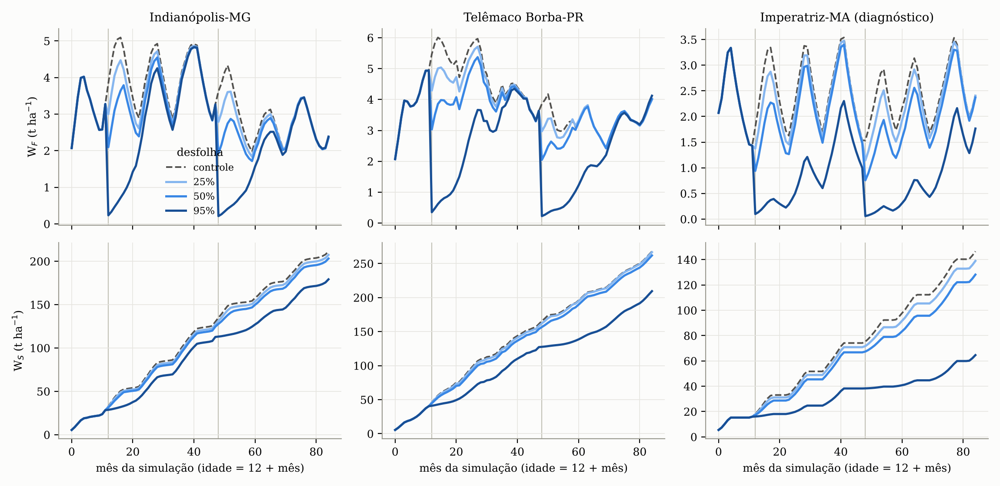

A frequência da desfolha é o segundo fator de perda, depois da intensidade. A Figura 2 mostra a perda de volume aos sete anos por intensidade e frequência, para A1 e C5.

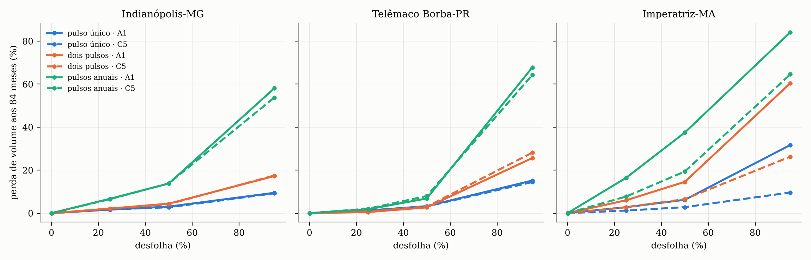

A época do ataque altera a perda. A Figura 3 compara 50% de desfolha em janeiro, abril, julho e outubro de 2017, nos três locais e em quatro clones. As barras mostram a chuva dos três meses seguintes ao ataque.

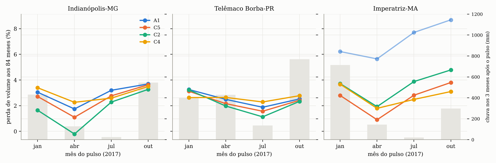

### 4.5 Solo e água

Com um ataque isolado de 50%, a Figura 4 mostra a perda de volume aos 84 meses nas 16 combinações de água (W25 a W100) e fertilidade (F25 a F100), nos três sítios e quatro materiais. A amplitude entre combinações varia de 0,4 ponto percentual em Indianópolis com A1 (2,9% a 3,3%) a 4,1 pontos em Telêmaco Borba com C2 (0,5% a 4,6%). O painel IMP–A1 é apenas diagnóstico, pois f_T = 0, e não integra a análise principal.

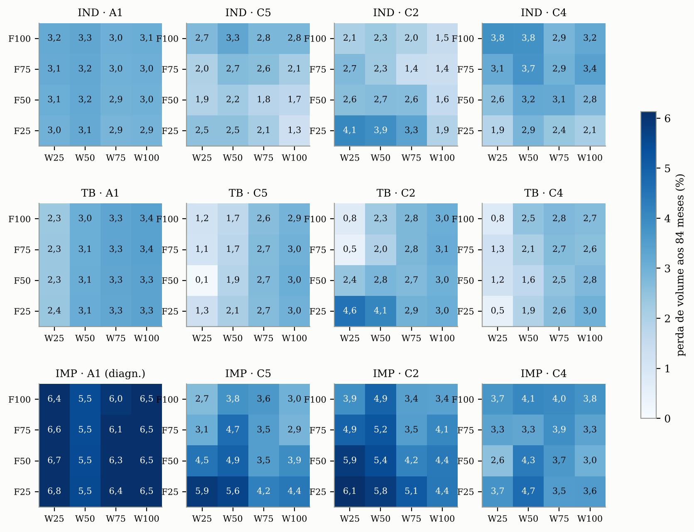

### 4.6 Recuperação da copa

A Figura 5 mostra, para 50% de desfolha, o tempo até a folhagem do talhão atacado alcançar 95% da do controle, conforme o nível de água. Nos três locais e nos quatro materiais, esse tempo fica entre 14 e 28 meses. Ele depende do local, do material e da água: em Telêmaco Borba, por exemplo, o clone C2 vai de 14 meses, com a menor água, a 22 meses. Na matriz completa de seis materiais, que inclui desfolhas menores e pontuais, 93,2% dos cenários calibrados com desfolha recuperam 95% da folhagem, com mediana de 6 meses; na versão original, são 51,6% dos cenários, com mediana de 26 meses. A diferença de escala entre a figura e a matriz se deve ao nível de desfolha: a figura usa 50%, e a matriz inclui cenários de todas as intensidades.

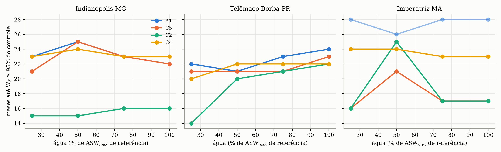

### 4.7 Fatores dominantes e sensibilidade

Um metamodelo de floresta aleatória foi ajustado para estimar as saídas simuladas a partir dos fatores de cenário. A validação cruzada em sete partes usou 1.848 cenários aptos dos três locais; o filtro de aptidão é aplicado antes do ajuste. Para a perda de volume aos 84 meses, o R² é de 0,993 (r = 0,996; RQEM de 11,3%). Para a perda de NPP acumulada, o R² é de 0,994. Para o tempo até a recuperação foliar, sobre 1.720 observações, o R² é de 0,923 (r = 0,961; RQEM de 8,1%). Na análise leave-one-site-out, a correlação entre o previsto e o simulado é de 0,966. A Figura 6 mostra a importância de cada fator e essa comparação entre locais. Essas métricas descrevem a reprodução de resultados do próprio modelo, não seu desempenho preditivo em campo.

Na Figura 6a, a intensidade responde por 64,7% da importância na recuperação foliar, a época por 9,4%, o material genético por 7,6%, o local por 7,2%, a fertilidade por 5,9% e a água por 5,2%. A frequência não tem efeito sobre a recuperação (0,0%). Na Figura 6b, com os três locais juntos, a intensidade responde por cerca de 58% da perda de volume e a frequência por cerca de 37%. Os demais fatores ficam abaixo de 2%. Como VPD não está entre as entradas do metamodelo, esses percentuais não informam sua importância nem permitem concluir que ele não contribua para os resultados.

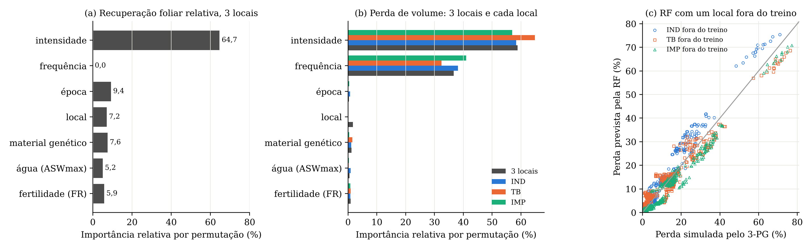

A Figura 7 mostra os oito parâmetros do clone A1 com maior efeito médio na perda de volume com 50% de desfolha, pelo método de Morris, nos três locais. Entre eles estão alphaCx, y, k e SLA0, que são parâmetros de dossel e de área foliar. A ordem entre eles muda de um local para outro. Os oito parâmetros de *E. globulus* não foram incluídos nessa análise, porque têm valor zero ou não admitem variação relativa. Para eles, foi feita uma análise exploratória com o clone A1 na versão calibrada, desfolha isolada de 50% e três sítios, com faixas sem fonte (±10% para valores não nulos; 0 e 0,1 para valores nulos). Os parâmetros kF, thinPower, mF, mR e mS não alteraram a perda nesse cenário, e Qa e Qb alteraram-na em no máximo 0,03 ponto percentual. O parâmetro MinCond não entra na análise principal: testado com o valor 0,1, produziu um ganho de 28,8% em Indianópolis, efeito considerado implausível. Como não há fonte para seu valor, MinCond é mantido com valor zero e sua influência é declarada como limite aceito desta versão.

### 4.8 Verificação e comparação com o experimento de Bertulio et al. (2008)

A verificação do código compara o motor do projeto com a implementação em Excel/VBA do 3-PG: o R² mínimo entre as duas versões é de 0,9996 e o RQEM máximo é de 0,13%. Em um crosscheck direto registrado no repositório, o pacote r3PG em R e o motor do projeto foram comparados em 23.873 pares por variável; a diferença relativa máxima foi de 5,288 × 10⁻¹⁵, abaixo do limite de 2 × 10⁻¹³. Esta verificação limitada ao conjunto registrado mede a implementação, não o desempenho do modelo, e não substitui inventários independentes.

A comparação com o experimento de Campo Verde-MT foi feita com dois clones, desfolhados totalmente duas vezes. Para o urograndis, a perda de volume por árvore aos 26 meses é de 52,1% sem ajuste, calculada como 100 × (1 − 0,0830/0,1734). Essa perda bruta inclui a diferença que já existia entre o tratamento e a testemunha no início do experimento. Ajustada pela linha de base, aos 14 meses, a perda é de 52,9%, calculada como 100 × [1 − (0,0830/0,1734) / (0,0523/0,0515)]. A Figura 8 usa o valor ajustado, porque é o que isola o efeito da desfolha. O Quadro 3 separa as três quantidades que devem ser comparadas, sempre no mesmo horizonte de 26 meses e na mesma unidade relativa.

**Quadro 3 – Perda de volume por árvore aos 26 meses no experimento de Campo Verde-MT e na previsão do modelo (%)**

| Material | Perda bruta observada | Perda ajustada pela linha de base | Previsão sem compensação | Previsão calibrada, com a observação escondida |
|---|---|---|---|---|
| Urograndis | 52,1 | 52,9 | 66,6 | 50,7 |
| Urocam | 65,7 | 59,0 | 79,3 | 62,9 |

A perda bruta mede a diferença entre tratamento e testemunha, sem descontar o que já existia no início. A perda ajustada desconta essa diferença inicial, aos 14 meses. A previsão calibrada usa o valor ajustado como alvo e não entra no ajuste. Para o urocam, a perda bruta aos 26 meses é de 65,7%, calculada como 100 × (1 − 0,0419/0,1221), e a ajustada pela linha de base é de 59,0%. Essas perdas são relativas a árvores individuais e não devem ser comparadas diretamente com os volumes por hectare do modelo. Para o C5, com desfolha de 0,95, o CAP ficou com RQEM de 7,6% e a altura subestimada em 12,2%. Essas medidas absolutas por árvore são comparadas separadamente: o volume por árvore do C5 foi subestimado em 61,4% (RQEM de 70,1%), e o do A1 em 47,5%, com o CAP do A1 com RQEM de 5,8%. A Figura 8 compara as perdas observadas, as simuladas sem compensação e as previstas pelo módulo calibrado com a observação escondida do ajuste. Sem compensação, o módulo superestima todas as variáveis: volume do urograndis 66,6% contra 52,9% observados, e volume do urocam 79,3% contra 59,0%. Com a compensação calibrada e a observação escondida, as previsões ficam mais próximas: volume do urograndis de 50,7% contra 52,9% observados (diferença de −2,2 pontos); altura do urograndis de 25,1% contra 19,1% (+6,0); volume do urocam de 62,9% contra 59,0% (+3,9); circunferência do urograndis de 20,3% contra 24,2% (−3,9); e circunferência do urocam de 27,6% contra 22,9% (+4,7).

A leitura é cautelosa. Com quatro observações por variável, o coeficiente de correlação alto (0,92 a 1,00) mostra apenas que o modelo ordena corretamente a testemunha e as desfolhadas, e não sustenta inferência. A subestimação do volume tem duas causas prováveis: o simulador calcula o volume de lenho sem casca e sem galhos, enquanto o observado é volume de Smalian; e as biomassas iniciais de Borges e Caldeira não são as desse plantio. Por isso, o volume absoluto não deve ser comparado diretamente entre essas fontes. Esta comparação não é uma validação.

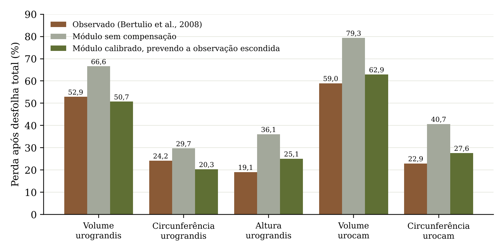

### 4.9 Biomas

Seis sítios, distribuídos em cinco biomas, foram simulados para o clone C5, com 50% de desfolha. O Cerrado é representado por Indianópolis e Imperatriz; os outros quatro biomas têm um sítio cada. A Figura 9 mostra a perda aos sete anos sem compensação e com a compensação calibrada, para uma desfolha e para desfolhas todos os anos, com a faixa de 90% da calibração.

### 4.10 Espaço de possibilidades do módulo

A Figura 10 reúne os 20.856 cenários aptos da matriz de seis materiais (10.428 por versão). Ela mostra a perda de volume aos sete anos para cada cenário (a) e a porcentagem de cenários em que a copa, o crescimento após o primeiro ano e o volume final alcançam o controle (b).

Na Figura 10b, a recuperação foliar é calculada entre os 8.448 cenários aptos com desfolha positiva por versão: 4.356 (51,6%) na versão original e 7.871 (93,2%) na calibrada recuperam 95% da folhagem do controle. Para NPP acumulada após o primeiro ano, o denominador é o conjunto completo de 10.428 cenários aptos por versão: 946 (9,1%) na versão original e 2.854 (27,4%) na calibrada superam o controle. O mesmo denominador é usado para o volume final: 2/10.428 (0,02%) na versão original e 180/10.428 (1,7%) na calibrada. Como os 180 ganhos calibrados estão todos entre cenários com desfolha positiva, eles correspondem a 2,1% dos 8.448 cenários desse subconjunto. Portanto, 1,7% é a proporção entre todos os cenários aptos da versão calibrada; 2,1% responde à pergunta condicional “entre os cenários com desfolha positiva”. A recuperação da copa não implica recuperação do incremento ou do volume final.

### 4.11 Plataforma

A plataforma Akademia Florestal apresenta o modelo calibrado em interface interativa; os resultados numéricos vêm do código de análise. A Figura 11 mostra a tela da plataforma, com as escolhas do cenário, os talhões controle e atacado e os resultados. A Figura 12 mostra o corte do tronco médio do talhão atacado em toras de serraria, celulose e energia.

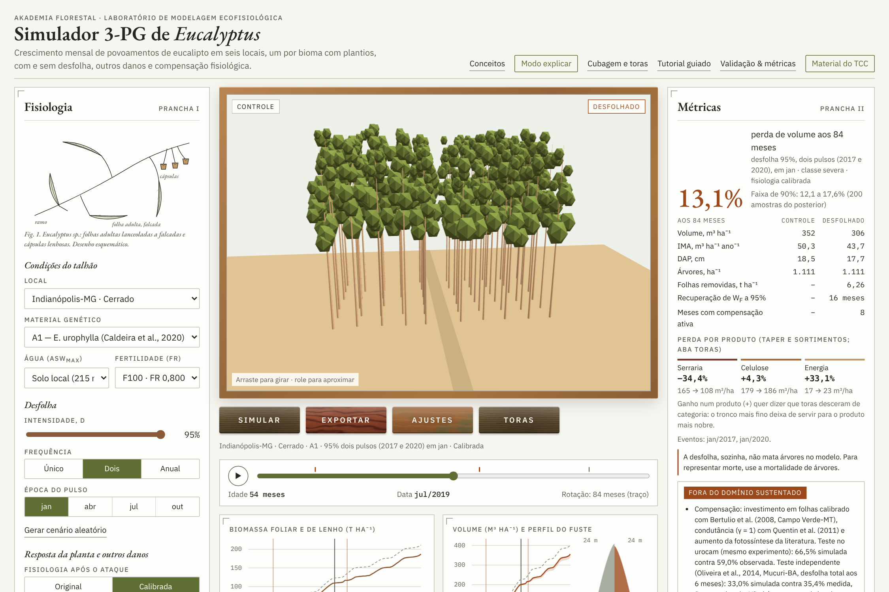

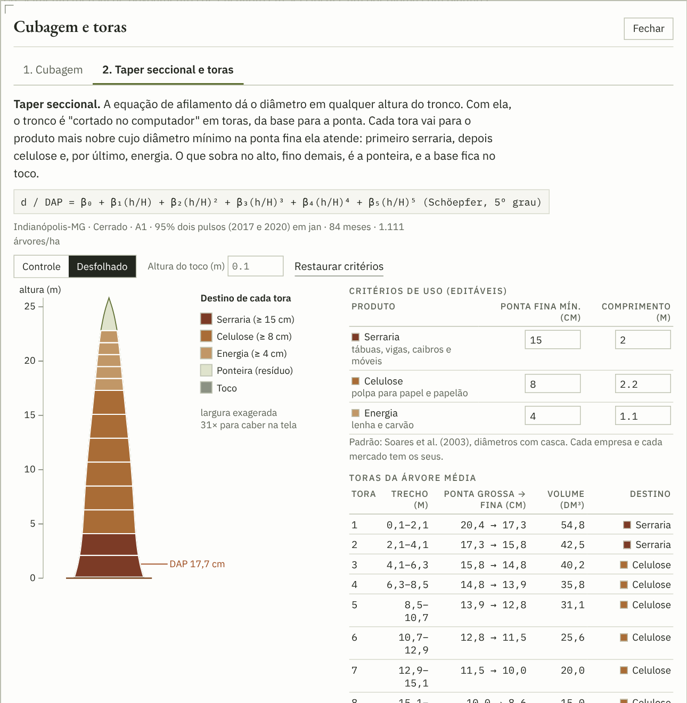

### 4.12 O que o modelo expressa

O módulo expressa, para os seis materiais e os três sítios avaliados nas Tabelas 1 e 2, como a perda de volume responde à intensidade e ao calendário do ataque, e como a compensação e a recuperação modificam essa resposta. Nos cenários simulados, a perda tende a crescer com a intensidade e com a repetição dos eventos. A comparação com Matrangolo et al. (2010) é de ordem de grandeza: naquele estudo, as desfolhas repetidas ocorreram no primeiro ano, e não em anos consecutivos. Em todos os materiais e sítios, a versão calibrada reduz a perda média em relação à original (por exemplo, A1 em IMP cai de 19,3% para 5,7%), o que indica que a compensação calibrada atenua a resposta do modelo.

### 4.13 Comparação com trabalhos anteriores

Rua et al. (2020) simularam perdas de 17,0% e 54,0% aos 10 anos para desfolhas de 25% e 50% da copa na primavera, em *E. globulus*. Os valores deste trabalho não são diretamente comparáveis, porque a espécie, o clima, o agente e o horizonte são diferentes.

Matrangolo et al. (2010) estudaram *E. grandis* de origem seminal em Viçosa-MG. Para a comparação aproximada registrada no repositório, o experimento foi representado em quatro tratamentos: uma desfolha aos 56 dias; duas aos 56 e 143 dias; duas aos 56 e 267 dias; e três aos 56, 143 e 278 dias após o plantio. O código `calibracao/testes_adicionais.py` converteu essas datas para o passo mensal do 3-PG, deslocando os eventos em 2,2 meses porque a parametrização C5 começa aos três meses de idade. Os eventos simulados ocorreram, respectivamente, aos 4; aos 4 e 7; aos 4 e 11; e aos 4, 7 e 11 meses de idade (maio, agosto e dezembro de 2015, conforme cada tratamento). Cada evento foi representado por desfolha de 99,9% (fração 0,999), não por remoção exatamente total.

Com o C5 e a compensação calibrada, as medianas simuladas aos 92 meses foram 3,8% para uma desfolha aos 4 meses; 8,1% para duas aos 4 e 7 meses; 8,3% para duas aos 4 e 11 meses; e 11,5% para três aos 4, 7 e 11 meses. Os valores observados usados na comparação foram 37,9%, 61,9%, 61,6% e 79,7%, respectivamente, calculados a partir dos volumes da Tabela 2 do estudo. A simulação usou clima NASA POWER de Viçosa de 2015 a 2024 e ASWmax de 215 mm, assumido por falta de dados locais; portanto, não reproduz o clima nem o solo do experimento. Além da diferença entre C5 (híbrido) e *E. grandis* seminal, o deslocamento temporal e a intensidade de 99,9% tornam esta uma comparação aproximada, não uma validação. A diferença entre as perdas simuladas e observadas é coerente com a limitação de persistência discutida a seguir.

### 4.14 Limites do modelo

O modelo não representa reservas de carbono não estruturais nem a reorganização fisiológica associada à sua mobilização. Mudas de *E. globulus* alteram biomassa, alocação e crescimento após desfolha, mas esses estudos não testam a persistência plurianual em plantios adultos (EYLES; PINKARD; MOHAMMED, 2009; EYLES et al., 2016). O modelo calibrado se recupera em até dois meses após uma desfolha pontual. Matrangolo et al. (2010) mostram que a perda pode persistir por anos e se acumular com desfolhas repetidas. Por isso, a versão calibrada tende a subestimar a perda acumulada, e as estimativas de longo prazo devem ser lidas como limites inferiores.

O modelo não possui relação observada entre desfolha e sobrevivência. A mortalidade imposta pode ser simulada como cenário, mas não deriva de campo. Mudas severamente desfolhadas podem sobreviver por mecanismos ligados ao lignotúber, sem que esse processo tenha sido quantificado em plantios adultos (BORZAK; POTTS; O'REILLY-WAPSTRA, 2016). A sobrevivência observada nos sítios da rede TECHS varia de 86% a 100% (CALDEIRA et al., 2020), e essa diferença não está representada.

A fertilidade é fixa por material. Não há estimativa de FR a partir do solo, porque a relação entre FR e propriedades do solo não está estabelecida (NUNES et al., 2022; NUNES et al., 2023).

A queda de folhada é outro ponto sensível. Firmino (2011), em povoamentos de *E. globulus* em Portugal, encontrou subestimação da folhada acumulada pelo 3-PG em ensaio de fertilização e rega, com três parcelas de 4,5 e 8,5 anos, e os resultados de folhada acumulada entre março e outubro de 2011 foram de 1,12, 1,86 e 2,82 Mg ha⁻¹. O autor recomenda pelo menos um ano completo de recolhas para confirmar a necessidade de revisar o submódulo de queda de folhada. Como a desfolha atua sobre a mesma área foliar que a queda de folhada controla, uma subestimação da queda de folhada afeta diretamente a recuperação simulada da copa. Este trabalho usa a taxa de queda de folhada de Caldeira et al. (2020) (γF0 = 0,062 e γFx = 0,13 por mês), que não foi testada contra folhada medida no Brasil.

Uma análise exploratória do modelo quantificou parte dessa incerteza sem alterar os parâmetros padrão. O *timing* da queda de folhada (γF1) produziu amplitudes de perda aos 72 meses de 0,95 ponto percentual em IND, 0,15 em TB e 0,58 em IMP quando variado em ±10%; γF0 e o tempo de transição produziram amplitudes de até 0,02 ponto percentual para os três locais. Entre oito parâmetros adaptados de *E. globulus*, três são desligados ou neutros na configuração testada (kF, mF e MinCond); entre os demais, Qb teve a maior amplitude, de 0,33 ponto percentual em IND, 0,02 em TB e 0,15 em IMP. Essas faixas são exercícios numéricos de incerteza, não parâmetros medidos no campo. O experimento de mortalidade de 0 a 15% produziu perdas adicionais de até 3,43 pontos percentuais em IND, 3,14 em TB e 4,30 em IMP, mas não representa sobrevivência individual variável em campo.

### 4.15 Confirmação empírica: condições para execução

Três tipos de dado poderiam apoiar a confirmação empírica do módulo, mas não foram acessados neste trabalho. Em particular, não tivemos acesso aos dados brutos de inventário das parcelas TECHS 9 e 22 nem a um conjunto independente que reúna clone comparável, série dendrométrica, IAF ou folhada, idade e histórico de desfolha. As comparações externas disponíveis são adaptadas e não constituem validação independente; não há solicitação de dados pendente nesta etapa.

1. **Crescimento sem desfolha em sítios com inventário.** Não foi localizado conjunto independente acessível com local, material, idade e variáveis dendrométricas correspondentes às simulações. Sem esses dados, não foi possível fazer essa comparação.
2. **Perda de volume em desfolha total.** O experimento de Oliveira et al. (2014) fornece uma comparação com perda de 35,4% em *E. grandis*. O modelo calibrado simulou 33,0% com o material C5, o que é uma comparação adaptada, não uma validação do clone A1.
3. **Desfolha repetida em campo.** Para validar a perda acumulada, é preciso um experimento com desfolhas repetidas em mais de um ano, com inventário em cada época e, idealmente, com medição de área foliar. Esse dado não existe para *E. urophylla* no conjunto disponível.

Os dados de campo necessários para a validação futura são: data de plantio, série mensal de clima do sítio, inventários em cada época (DAP, altura, volume), área foliar ou índice de área foliar em pelo menos duas épocas, e a fração de copa desfolhada em cada evento. Com esses dados, o modelo pode ser testado para cada material e sítio, com métricas de erro (RMSE, MAE, viés e R²) e número de observações.

## 5 CONCLUSÃO

O módulo de desfolha acoplado ao 3-PG foi avaliado com seis materiais nos três sítios brasileiros das Tabelas 1 e 2. As simulações mostram que a perda de volume aumenta com a intensidade e a repetição do ataque, e que a versão calibrada reduz a perda média em relação à original. A resposta varia entre materiais e sítios, com maior perda em IMP e nos cenários de desfolha severa.

Os resultados são previsões do modelo, não medições. A validação de crescimento sem desfolha, a validação de desfolha repetida e a análise de sensibilidade aos oito parâmetros de *E. globulus* são etapas que dependem de dados de campo e de trabalho adicional. Os ganhos de volume observados em alguns cenários calibrados ainda não têm explicação física confirmada.

## REFERÊNCIAS

BERTULIO, V. G.; PERES FILHO, O.; SILVA, É. G. da; DORVAL, A. Crescimento de clones de *Eucalyptus* spp. submetidos a desfolha artificial sucessiva. *Revista de Agricultura*, v. 83, n. 2, p. 119–124, 2008. DOI: 10.37856/bja.v83i2.1477.

BINKLEY, D. et al. The interactions of climate, spacing and genetics on clonal *Eucalyptus* plantations across Brazil and Uruguay. *Forest Ecology and Management*, v. 405, p. 271–283, 2017. DOI: 10.1016/j.foreco.2017.09.050.

BORGES, J. S. et al. Parametrização do modelo 3-PG para eucalipto na região do cerrado de Minas Gerais. *Ciência Florestal*, v. 22, n. 3, p. 567–578, 2012. DOI: 10.5902/198050986623.

BORGES, J. S. *Parametrização, calibração e validação do modelo 3-PG para eucalipto na região do cerrado de Minas Gerais*. Dissertação (Mestrado em Solos e Nutrição de Plantas) – Universidade Federal de Viçosa, Viçosa, 2009.

BORZAK, C. L.; POTTS, B. M.; O'REILLY-WAPSTRA, J. M. Survival and recovery of *Eucalyptus globulus* seedlings from severe defoliation. *Forest Ecology and Management*, v. 379, p. 243–251, 2016. DOI: 10.1016/j.foreco.2016.08.025.

CALDEIRA, D. R. M. et al. Multisite evaluation of the 3-PG model for the highest phenotypic plasticity *Eucalyptus* clone in Brazil. *Forest Ecology and Management*, v. 462, 117989, 2020. DOI: 10.1016/j.foreco.2020.117989.

EYLES, A.; PINKARD, E. A.; MOHAMMED, C. Shifts in biomass and resource allocation patterns following defoliation in *Eucalyptus globulus* growing with varying water and nutrient supplies. *Tree Physiology*, v. 29, n. 6, p. 753–764, 2009. DOI: 10.1093/treephys/tpp014.

EYLES, A. et al. Recovery after defoliation in *Eucalyptus globulus* saplings: respiration and growth. *Trees*, v. 30, n. 5, p. 1543–1555, 2016. DOI: 10.1007/s00468-016-1388-3.

FIRMINO, P. N. *Análise do módulo da queda de folhada em eucaliptais no modelo 3-PG*. Dissertação (Mestrado em Engenharia Florestal e dos Recursos Naturais) – Instituto Superior de Agronomia, Universidade de Lisboa, Lisboa, 2011.

LANDSBERG, J. J.; WARING, R. H. A generalised model of forest productivity using simplified concepts of radiation-use efficiency, carbon balance and partitioning. *Forest Ecology and Management*, v. 95, p. 209–228, 1997. DOI: 10.1016/S0378-1127(97)00026-1.

MATRANGOLO, C. A. R.; CASTRO, R. V. O.; DELLA LUCIA, T. M. C.; DELLA LUCIA, R. M.; MENDES, A. F. N.; COSTA, J. M. F. N.; LEITE, H. G. Crescimento de eucalipto sob efeito de desfolhamento artificial. *Pesquisa Agropecuária Brasileira*, Brasília, v. 45, n. 9, p. 952–957, 2010. DOI: 10.1590/S0100-204X2010000900003.

NUNES, J. D.; OLIVEIRA, T. S.; CORTEZ, N.; TOMÉ, M. Modelação do índice de fertilidade do 3-PG em função de características físicas e químicas do solo. *Revista de Ciências Agrárias*, v. 45, n. 4, p. 487–491, 2022. DOI: 10.19084/rca.28574.

NUNES, J. D.; BARREIRO, S.; CORTEZ, N.; TOMÉ, M. Modificador de fertilidade do 3-PG em função dos teores de nutrientes do solo. *Revista de Ciências Agrárias*, v. 46, n. especial 1, p. 111–115, 2023. DOI: 10.19084/rca.33401.

OLIVEIRA, M. A. et al. The simulated effect of defoliation in the growth of the *Eucalyptus grandis*. *Chemical Engineering Transactions*, v. 39, p. 1543–1548, 2014. DOI: 10.3303/CET1439258.

RUA, J. C. P. et al. Estimating defoliation impact of *Gonipterus platensis* on *Eucalyptus globulus* stands productivity using a forest simulator based on 3-PG. *Forest Ecology and Management*, v. 478, 118495, 2020. DOI: 10.1016/j.foreco.2020.118495.

ALMEIDA, Maria Naruna Felix de. *Efeito do clima nas características e propriedades da madeira de um clone de *Eucalyptus urophylla**. Tese (Doutorado em Ciências Florestais) – Universidade Federal do Espírito Santo, Jerônimo Monteiro, 2021.

SANDS, P. J.; LANDSBERG, J. J. Parameterisation of 3-PG for plantation grown *Eucalyptus globulus*. *Forest Ecology and Management*, v. 163, p. 273–292, 2002. DOI: 10.1016/S0378-1127(01)00586-2.
