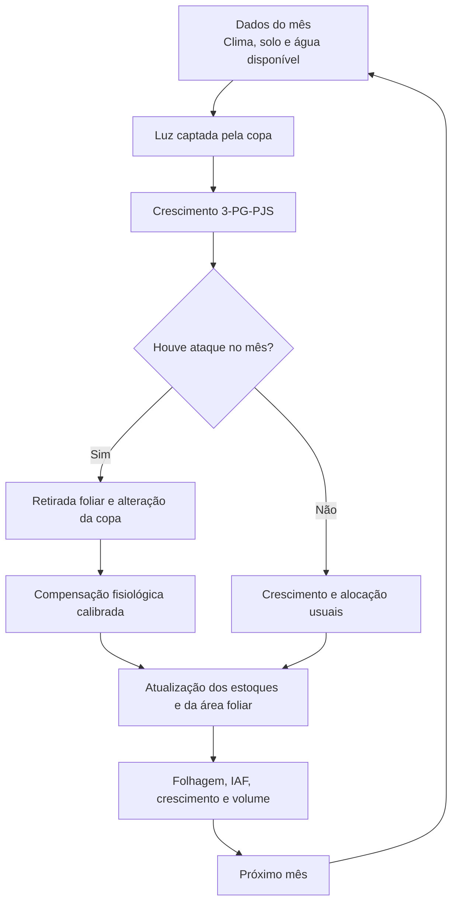
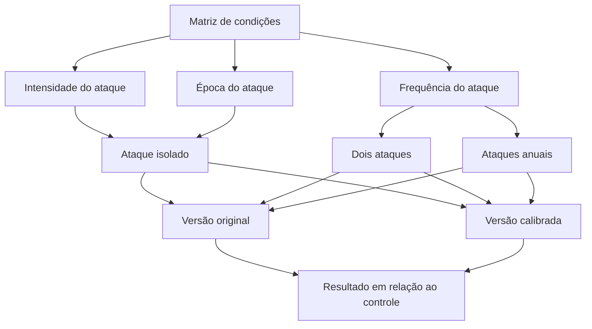
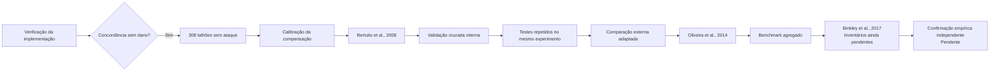
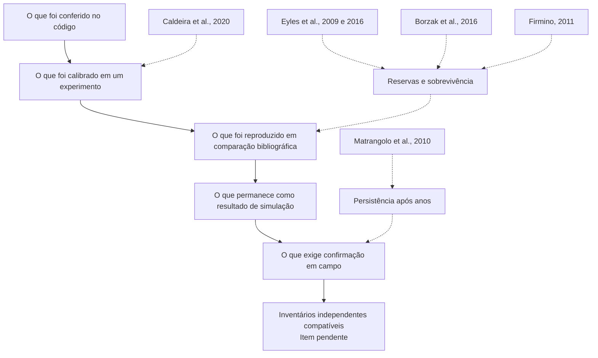

# Fluxogramas explicativos do Material e Métodos

Este arquivo reúne cinco fluxogramas prontos para o infográfico acadêmico do TCC.
Devem ser apresentados em português claro, no estilo de infográfico encadeado do Notelm:
forma simples, etapas numeradas, textos curtos e uma distinção visual entre dados, código,
calibração, simulação e evidência empírica.

Não mostrar “pulso/pulsos”, P1/P2/PA ou siglas sem a primeira definição. Nos rótulos
visíveis, usar “ataque isolado”, “dois ataques” e “ataques anuais”.

## 1. Arquitetura geral do estudo

Texto de ligação:

- **Objetivo:** pergunta de pesquisa e domínio de aplicação.
- **Entradas:** dados secundários climatológicos, edáficos e de materiais, sem coleta de campo.
- **3-PG mensal:** calcula crescimento a partir dos processos mensais da planta e do ambiente.
- **Danos:** transforma o ataque em retirada foliar e modifica a resposta da planta.
- **Cenários:** combina fatores para comparar resultados pareados com o controle.
- **Calibração:** ajusta a reação fisiológica em dados existentes.
- **Metamodelo:** resume padrões entre entradas e resultados das simulações.
- **Interpretação:** separa resultado simulado de confirmação em campo.

## 2. Ciclo mensal do 3-PG com desfolha

Referência de ligação: o modelo original não representa a retirada de folhas; Rua et al.
(2020) é precedente de integração da desfolha ao 3-PG. A compensação foi calibrada com
dados de Bertulio et al. (2008), sem apresentar o mecanismo como confirmação fisiológica
independente.

## 3. Construção dos cenários

Cada caminho deve ser identificado por intensidade, época, frequência e estado do solo ou
da fertilidade. Os calendários visíveis devem usar “ataque isolado”, “dois ataques” e
“ataques anuais”; essa nomenclatura não cria um novo processo biológico. Os três primeiros
diagramas foram reorganizados em percursos compactos e as imagens foram ampliadas para
ocupar a largura útil da página sem reduzir a leitura do texto.

## 4. Calibração, verificação e evidências

Legenda científica obrigatória:

- **Verificação:** confere o código e a reprodução do motor sem desfolha.
- **Calibração:** estima parâmetros usando Bertulio et al. (2008).
- **Validação cruzada interna:** esconde partes do mesmo experimento e tenta prevê-las.
- **Comparação adaptada:** compara uma previsão com Oliveira et al. (2014), em outra
  condição e horizonte curto.
- **Benchmark agregado:** compara resultados gerais de TECHS; não substitui inventários
  independentes por variável.
- **Confirmação empírica independente:** ainda depende de inventários compatíveis e séries
  de campo, com material, idade e unidades confirmados.

## 5. Escada de interpretação e limites

O infográfico deve explicar por que a cadeia termina em **confirmação pendente**:

- Eyles et al. (2009, 2016), Borzak et al. (2016) e Firmino (2011) fornecem evidências
  sobre reservas, sobrevivência, rebrote ou folhada em condições específicas.
- Matrangolo et al. (2010) demonstra o limite entre resposta de curto prazo e persistência
  após desfolhas severas.
- Caldeira et al. (2020) sustenta a avaliação do crescimento sem desfolha em sítios TECHS;
  não valida o módulo de desfolha.
- Binkley et al. (2017) fornece dados agregados de TECHS, mas não substitui séries brutas
  nem inventários independentes compatíveis.

## Referências para os textos visuais

| Referência | Uso permitido no infográfico |
|---|---|
| Bertulio et al. (2008) | Fonte da calibração e da validação cruzada interna. |
| Rua et al. (2020) | Precedente de integração de desfolha ao modelo 3-PG. |
| Caldeira et al. (2020) | Verificação ou benchmark de crescimento sem desfolha em TECHS. |
| Oliveira et al. (2014) | Comparação externa adaptada de curto prazo. |
| Matrangolo et al. (2010) | Evidência contrária sobre persistência de perdas plurianuais. |
| Eyles et al. (2009, 2016) | Reservas e alocação em condições específicas. |
| Borzak et al. (2016) | Sobrevivência e lignotúber em mudas, não persistência adulta. |
| Firmino (2011) | Evidência de folhada em E. globulus. |
| Binkley et al. (2017) | Benchmark agregado TECHS; inventários brutos não localizados. |

Os fluxogramas distinguem comparação adaptada de confirmação empírica. Não há acesso aos
dados brutos de inventário TECHS nesta etapa; os resultados agregados publicados não são
tratados como validação independente.

## Arquivos de imagem gerados

Cada diagrama possui fonte Mermaid (`.mmd`) e exportações (`.svg` e `.png`) em
`handoff_claude/diagramas/`. Os quatro primeiros também são renderizados por
`render_fluxogramas.py`, para garantir tipografia legível no DOCX sem depender de Mermaid CLI.
Para regenerar esses quatro pares de imagens, execute
`python handoff_claude/diagramas/render_fluxogramas.py`; mantenha os rótulos e as relações
sincronizados entre o Mermaid e o renderizador.

| Fluxograma | PNG | SVG |
|---|---|---|
| Arquitetura geral | [01-arquitetura-geral.png](diagramas/01-arquitetura-geral.png) | [01-arquitetura-geral.svg](diagramas/01-arquitetura-geral.svg) |
| Ciclo mensal | [02-ciclo-mensal.png](diagramas/02-ciclo-mensal.png) | [02-ciclo-mensal.svg](diagramas/02-ciclo-mensal.svg) |
| Construção dos cenários | [03-cenarios.png](diagramas/03-cenarios.png) | [03-cenarios.svg](diagramas/03-cenarios.svg) |
| Calibração e evidências | [04-calibracao-evidencias.png](diagramas/04-calibracao-evidencias.png) | [04-calibracao-evidencias.svg](diagramas/04-calibracao-evidencias.svg) |
| Escada de interpretação | [05-escada-interpretacao.png](diagramas/05-escada-interpretacao.png) | [05-escada-interpretacao.svg](diagramas/05-escada-interpretacao.svg) |
